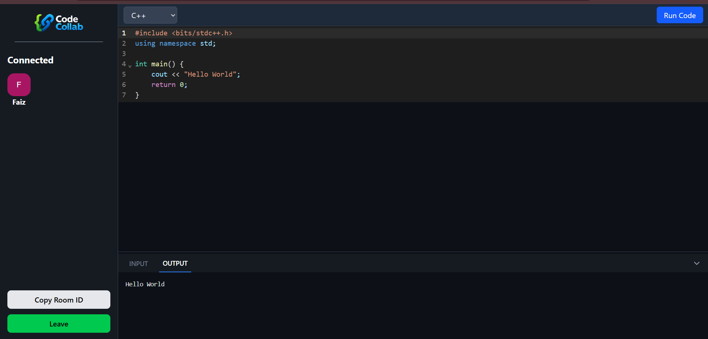

# 💻 Code Collab – Real-Time Collaborative Code Editor

A full-stack real-time collaborative coding platform that enables multiple users to write, edit, and execute code together in the same room. Built with real-time synchronization using Socket.io and online code execution through the OneCompiler API.

## 🚀 Features

- 👥 Create and join coding rooms
- ⚡ Real-time code collaboration powered by Socket.io
- 🌐 Multi-language support — C++, Java, Python, JavaScript
- 🔄 Real-time language synchronization
- ⌨️ Shared program input
- ▶️ Online code execution
- 📤 Real-time execution output
- 🟢 Connected users display
- ✍️ Real-time typing indicator
- 📋 Copy room ID functionality
- ↕️ Resizable Input/Output panel
- 🎨 Modern dark-themed code editor

## 🛠️ Tech Stack

- **Frontend:** React, Vite, Tailwind CSS, CodeMirror
- **Backend:** Node.js, Express.js
- **Real-Time Communication:** Socket.io
- **Code Execution:** OneCompiler API
- **Deployment:** Vercel, Render

## 📌 Upcoming Features

- 🤖 AI-powered code review
- 🧠 AI debugging and coding assistance
- 🔍 Static code analysis
- 📊 Code complexity analysis
- 💾 Persistent code history
- 🔐 User authentication
- 📁 Multi-file project support
- 🌐 More programming languages

## 🔗 Project Link

👉 **Live Project:** https://code-collab-hazel-sigma.vercel.app/

👉 **Backend:** https://code-collab-th6k.onrender.com

## 📷 Screenshot

<!-- Add your project screenshot here -->

## 💡 Why This Project Matters

Code Collab demonstrates the ability to build a real-time collaborative application where multiple users can work on the same code simultaneously.

This project highlights:

- Real-time synchronization of code, language, and input using Socket.io.
- Multi-user room management and presence tracking.
- Integration of an external code execution API with a Node.js backend.
- Handling real-time events such as typing, joining, leaving, and code execution.
- Building a responsive code editor interface with CodeMirror.
- Deploying a React frontend and Node.js backend using Vercel and Render.
