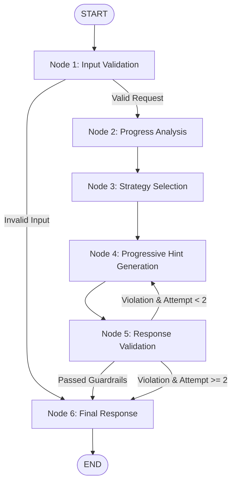

# Code Collab – AI Coding Tutor Microservice (Phase 5A)

The **AI Coding Tutor Microservice** is a high-performance Python FastAPI service powered by **LangChain**, **LangGraph**, and **Groq**. It provides adaptive, Socratic hints to students solving coding problems without leaking full programs or copy-paste-ready solutions.

---

## 1. Architecture & LangGraph Workflow

The tutor executes a deterministic 6-stage state machine workflow using **LangGraph**:



### Stage Breakdown
1. **Node 1: Input Validation (`validate_input`)**
   - Validates problem metadata, supported language (`cpp`, `java`, `python`, `javascript`), code size, and requested hint level (1–4).
   - Enforces a 60,000 character maximum payload boundary.
2. **Node 2: Progress Analysis (`analyze_progress`)**
   - **Hybrid approach**: Combines fast deterministic heuristic analysis (empty code, starter boilerplate, passed test ratios) with LLM code reasoning.
   - Categorizes student progress into: `NO_CODE`, `INITIAL_IMPLEMENTATION`, `PARTIAL_IMPLEMENTATION`, `LOGIC_ISSUE`, `IMPLEMENTATION_BUG`, `NEARLY_SOLVED`, or `SOLVED`.
3. **Node 3: Strategy Selection (`select_strategy`)**
   - Maps the progress category and target hint level to tailored pedagogical guidance instructions.
4. **Node 4: Progressive Hint Generation (`generate_hint`)**
   - Generates progressive guidance:
     - **Level 1 (Conceptual):** Algorithmic mental model, concept, or data structure.
     - **Level 2 (Approach):** Logical sub-tasks and step-by-step structure.
     - **Level 3 (Debugging):** Targeted variable/condition inspection for specific flaws.
     - **Level 4 (Edge-Cases):** Boundary conditions and extreme values.
5. **Node 5: Response Validation (`validate_response`)**
   - **Guardrails**: Inspects generated text for complete solution leakage (e.g. `int main()`, `public static void main`), false claims of executing student code, hidden test references, or hint repetition.
   - Triggers one controlled re-generation if violations are detected.
6. **Node 6: Final Response (`finalize_response`)**
   - Wraps validated payload into a structured Pydantic `HintResponse`, or applies a safe pedagogical fallback if provider errors occurred.

---

## 2. Directory Structure

```
backend-ai/
├── app/
│   ├── main.py                  # FastAPI application entrypoint & exception handlers
│   ├── config.py                # Pydantic Settings & environment variable configuration
│   ├── api/
│   │   └── routes/
│   │       └── tutor.py         # POST /api/tutor/hint endpoint with secret auth
│   ├── agents/
│   │   ├── tutor_state.py       # LangGraph TypedDict state model
│   │   ├── nodes.py             # Individual workflow node implementations
│   │   └── tutor_graph.py       # Compiled StateGraph workflow definition
│   ├── services/
│   │   ├── llm_service.py       # LangChain ChatGroq provider integration & mock injection
│   │   ├── progress_analyzer.py # Hybrid deterministic & LLM progress analyzer
│   │   └── hint_service.py      # Strategy prompt builder & LLM caller
│   ├── prompts/
│   │   └── tutor_prompts.py     # System instructions and pedagogical constraints
│   ├── schemas/
│   │   └── tutor_schema.py      # Pydantic request, response, and health models
│   └── utils/
│       └── response_validator.py# Guardrails against complete solution leaks & repetitions
├── tests/
│   ├── conftest.py              # Mock LLM fixtures (zero API credits consumed during tests)
│   ├── test_tutor_api.py        # Health, validation, auth, and HTTP endpoint tests
│   ├── test_progress_analyzer.py# Deterministic and algorithmic categorization tests
│   ├── test_hint_generation.py  # Hint continuity, LangGraph order, and LLM error fallbacks
│   └── test_security.py         # Complete solution leakage, hidden test exclusion, and privacy tests
├── requirements.txt
├── pytest.ini
├── .env.example
└── README.md
```

---

## 3. Setup & Installation

### Prerequisites
* Python 3.10+ (tested with Python 3.13)

### Step 1: Create Virtual Environment
```bash
cd backend-ai
python -m venv .venv
```

### Step 2: Activate Virtual Environment
* **Windows (PowerShell):**
  ```powershell
  .venv\Scripts\Activate.ps1
  ```
* **macOS / Linux:**
  ```bash
  source .venv/bin/activate
  ```

### Step 3: Install Dependencies
```bash
pip install -r requirements.txt
```

### Step 4: Environment Variables Setup
Copy `.env.example` to `.env`:
```bash
cp .env.example .env
```
Populate `.env` with your values:
```env
AI_SERVICE_PORT=8000
AI_SERVICE_SECRET=dev_ai_secret_codecollab

GROQ_API_KEY=your_groq_api_key_here
GROQ_MODEL=llama-3.3-70b-versatile
GROQ_TEMPERATURE=0.3
GROQ_MAX_TOKENS=1024
GROQ_REQUEST_TIMEOUT=20.0
MAX_REQUEST_CHARS=60000
```

---

## 4. Running the Service Locally

Start the FastAPI server via Uvicorn:
```bash
uvicorn app.main:app --host 0.0.0.0 --port 8000 --reload
```
Interactive Swagger documentation is available at: [http://localhost:8000/docs](http://localhost:8000/docs).

---

## 5. API Reference

### Health Check
* **Endpoint:** `GET /health`
* **Auth:** None (Public)
* **Response:**
```json
{
  "status": "ok",
  "service": "ai-coding-tutor",
  "version": "1.0.0",
  "model": "llama-3.3-70b-versatile"
}
```

### Generate Adaptive Hint
* **Endpoint:** `POST /api/tutor/hint`
* **Auth:** Required (`X-Service-Secret: <AI_SERVICE_SECRET>` or `Authorization: Bearer <AI_SERVICE_SECRET>`)
* **Example Request:**
```json
{
  "problem": {
    "title": "Two Sum",
    "description": "Given an array of integers nums and an integer target, return indices of the two numbers such that they add up to target.",
    "inputFormat": "First line contains array size, second line contains integers, third line contains target.",
    "outputFormat": "Two space-separated indices.",
    "constraints": "2 <= nums.length <= 10^4"
  },
  "code": "vector<int> twoSum(vector<int>& nums, int target) {\n    for(int i = 0; i < nums.size(); ++i) {\n        // partial logic\n    }\n}",
  "language": "cpp",
  "testResults": {
    "passed": 2,
    "failed": 3,
    "total": 5,
    "verdict": "Wrong Answer"
  },
  "previousHints": [
    {
      "hintLevel": 1,
      "hintTitle": "Data Structure Choice",
      "hint": "Consider using a hash map to remember numbers you have already seen in O(1) time."
    }
  ],
  "requestedHintLevel": 2
}
```

* **Example Response:**
```json
{
  "success": true,
  "progressCategory": "PARTIAL_IMPLEMENTATION",
  "hintLevel": 2,
  "hintTitle": "Building the Hash Map Lookup",
  "hint": "As you iterate through the array, calculate the complement (target - current_value). Check if this complement already exists in your map before inserting the current number.",
  "nextAction": "Write an if-condition inside your loop checking if target - nums[i] is already in the map.",
  "solved": false
}
```

---

## 6. Running Automated Tests

All tests utilize a deterministic mocked LLM fixture, guaranteeing **zero Groq API credits** are consumed during testing:
```bash
pytest
```
* **Coverage:** 23 automated tests covering health, request validation, authentication, hybrid progress analyzer, hint continuity, timeout/rate-limit fallbacks, solution leakage prevention, hidden test exclusion, and stateless privacy.
